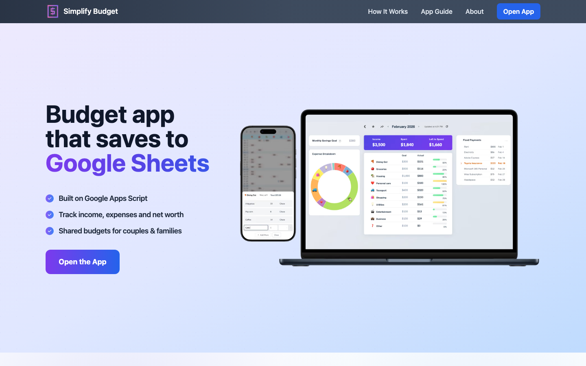

# Simplify Budget

A free budgeting app that keeps every number in your own Google Sheet. Track expenses, subscriptions and net worth from any device, and own the data outright.

[](https://simplifybudget.vercel.app)

**[Website](https://simplifybudget.vercel.app)** · **[Open the app](https://script.google.com/macros/s/AKfycbxzQyt4DRFwscUe5INomAYM2yDsYVbU1PuPkGJQyPSMb5pfPeL4XWxoDIBeOYmCoaax/exec)**

## What you get

- Expenses by category, with monthly budgets and a savings goal
- Fixed costs and subscriptions logged for you every month
- A calendar grid that shows which days you spent and which you didn't
- Net worth over time: savings, investments and debts
- Monthly charts, 30 custom categories, several languages and currencies

Everything lives in a Google Sheet in your Drive. There's no outside database, and you can open the sheet and do whatever you want with it.

## Run your own copy

It's a Google Apps Script web app, deployed with [clasp](https://github.com/google/clasp).

```bash
npm install -g @google/clasp
clasp login
clasp create --title "Simplify Budget" --type standalone
clasp push
clasp deploy
```

Then open the app, paste your Google Sheet's ID into **Settings**, and click **Test Connection**.

## License

[AGPL-3.0](LICENSE)
